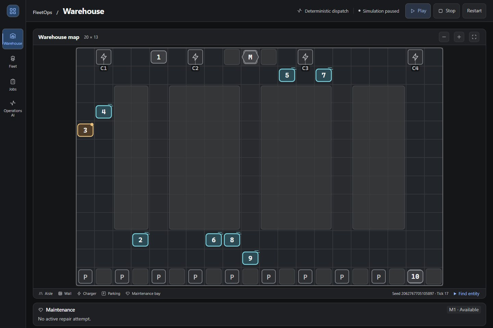
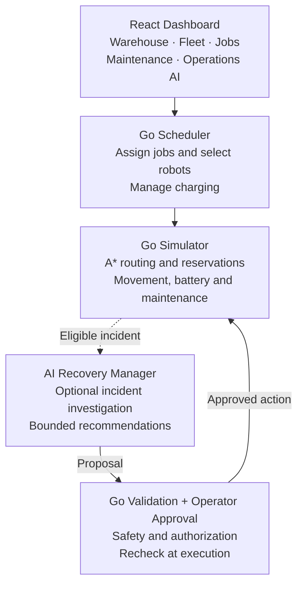
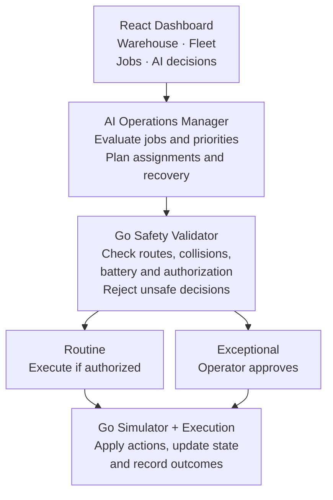
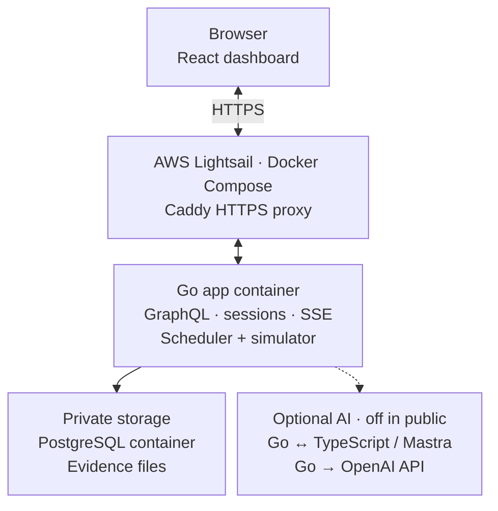

# FleetOps

FleetOps is a warehouse robot fleet management simulator. Robots receive transport jobs, navigate shared routes, charge their batteries, and deal with breakdowns while an operator follows the warehouse from a browser.

Go assigns routine work and enforces safety. An optional AI recovery worker can investigate exceptional incidents and recommend an action. Go owns validation and execution, and the recovery proposal needs independent operator approval. The public deployment runs deterministic Go operations with paid OpenAI inference disabled.

## Live demo

Open [fleetops-ai.freeddns.org](https://fleetops-ai.freeddns.org) and press **Play** in Warehouse. The floor has ten transport robots and one maintenance robot, marked **M**. Watch jobs get assigned and delivered, inspect robot movement and charging, and follow faults and repair attempts in the Maintenance and Operations AI views.

Each visitor gets a separate simulation and database schema. A session lasts up to 20 minutes, and the server supports eight concurrent visitors. This release adds a FleetOps busy page with a retry link for when all eight slots are in use.



## How FleetOps works

1. A job arrives with a pickup and delivery cell. Go evaluates eligible transport robots and assigns the work.
2. The simulator uses A* to find a route through the warehouse grid. Robots reserve upcoming cells so they can share aisles without occupying the same space.
3. Go manages battery use and sends eligible robots to available chargers. If a robot breaks down, the simulator can send the maintenance robot to a reachable service cell and verify the repair before resuming work. Some faults still need outside help.
4. With the recovery worker enabled, Go can send an incident snapshot for investigation. The worker can recommend a bounded intervention or abstain when the evidence is insufficient. A recommendation is a request for review.
5. An operator approves or rejects a recovery proposal. Go rechecks authorization and live conditions before applying an approved action. PostgreSQL holds proposal and audit records, and the browser receives fleet updates over Server-Sent Events (SSE).

### Current architecture — Go-led operations



Job J25 arrives. Go selects an eligible robot, assigns the job, and plans its route. If a robot develops a problem, the optional recovery worker can investigate and propose an intervention. Go validates the proposal and checks it again before an approved action executes.

### Planned architecture — not yet implemented



In this design, J25 arrives and the AI Operations Manager proposes assigning it to R6. Go checks eligibility and safety before execution. An exceptional intervention still waits for an operator. The next step is to move routine assignment and prioritization into this proposal flow while keeping validation results, decisions, and outcomes auditable.

### Technical infrastructure



Caddy and the Go app run in separate containers. When enabled, the Mastra worker exchanges incident snapshots and recommendations with Go over standard input and output. Go sends OpenAI requests on the worker's behalf.

## Stack and engineering decisions

| Technology | Responsibility |
| --- | --- |
| Go | Owns scheduling, simulation state, collision and battery rules, and command execution. Deterministic rules can be checked against the live simulator state at execution time. |
| React and TypeScript | Render the warehouse map and operator views. TypeScript also defines the worker's observation and decision contracts. |
| GraphQL and SSE | GraphQL provides role-scoped reads and proposal decisions. SSE streams warehouse state and activity updates to the dashboard. |
| PostgreSQL | Stores proposals, audit records, and optional provider accounting. Per-visitor schemas isolate workflow data. The simulator itself runs in memory. |
| Mastra and OpenAI | Mastra investigates a detached incident snapshot. In the optional V3 path, Go applies request and spending limits before forwarding provider calls. The worker cannot approve or execute a proposal. |
| Docker and Docker Compose | Package the React build and Go server, with the worker in the optional Operations image. Compose runs the app, database, and proxy with private database networking and persistent storage. |
| Caddy and AWS Lightsail | Caddy terminates HTTPS on the Lightsail host. The app and database ports stay private. |
| GitHub Actions | Runs test, integration, and secret-scanning checks. The main branch image workflow publishes to GHCR. |

## Limits and further reading

FleetOps simulates a warehouse grid. It cannot control physical robots. Visitor capacity and session time are bounded. A completed session's workflow evidence is archived before its schema is removed. In-memory fleet state cannot be resumed from the audit archive.

Recovery recommendations are limited to supported actions and must be grounded in observed fleet state. Paid inference is off in production, and Go still owns routine dispatch. The AI-led dispatch diagram describes planned work.

- [Architecture and design decisions](docs/architecture.md) · [Safety rules](docs/safety-rules.md)
- [Visitor isolation and limits](docs/pub-02.md) · [Lightsail deployment runbook](docs/pub-03.md)
- [Recovery decision contract](docs/recovery-decision-v3.md) · [Operations Manager configuration](docs/operations-manager.md)
- [Evaluation guide](evals/README.md) · [Recorded evaluation results and methodology](docs/phase5-evaluation-report.md)

## Run locally

Use Node.js 24.21.0, Go 1.27.1, and PostgreSQL 18.6. Create a dedicated local database and role that can create schemas, then supply its connection URL through the private `FLEETOPS_DATABASE_URL` environment variable. From the repository root in PowerShell 7:

```powershell
npm ci --prefix web
npm --prefix web run build

$env:PORT = '8080'
$env:FLEETOPS_MODE = 'local'
$env:FLEETOPS_PUBLIC_ORIGIN = 'http://127.0.0.1:8080'
$env:FLEETOPS_ASSETS_DIR = (Resolve-Path web/dist).Path
$env:FLEETOPS_EVIDENCE_DIR = (New-Item -ItemType Directory (Join-Path ([IO.Path]::GetTempPath()) ([guid]::NewGuid().ToString()))).FullName
$env:FLEETOPS_START_WAREHOUSE_V2 = '1'
$env:FLEETOPS_OPERATIONS_ENABLED = '0'
Set-Location backend
go run ./cmd/server
```

Open [127.0.0.1:8080](http://127.0.0.1:8080) and stop the server with Ctrl+C so it can archive sessions. See the [visitor configuration](docs/pub-02.md#configuration-and-deployment-preparation) for environment details. The [scripted proposal demo](docs/phase4-demo.md) and [evaluation workflows](evals/README.md) are separate from the normal application.
