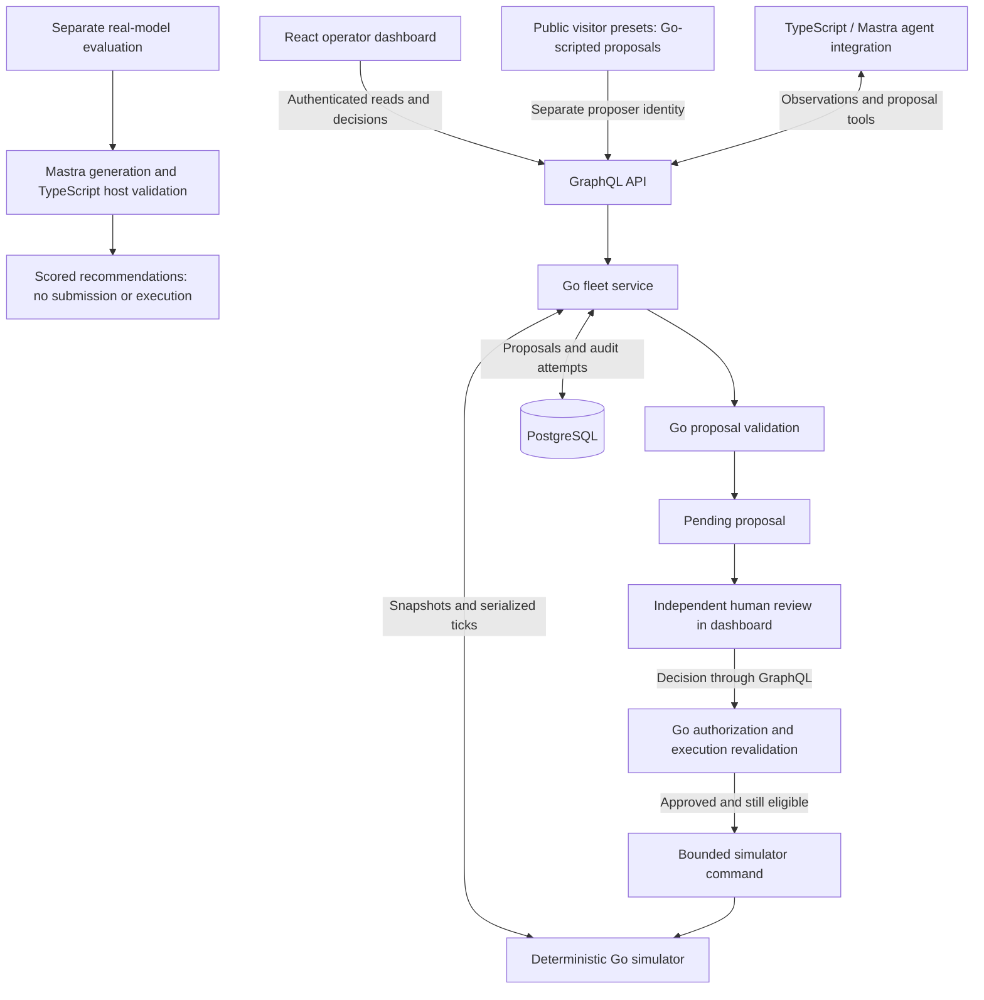

# FleetOps

**AI-assisted warehouse robot fleet management, with deterministic simulation and human-controlled recovery.**

FleetOps connects robot telemetry and incident detection to bounded response proposals, operational safety checks, operator review, and audited execution. It combines a Go fleet simulator, a TypeScript/Mastra agent, and a React dashboard to make each step from recommendation to outcome inspectable.

**LLM proposes. Go validates. Human approves. Go executes.**

## Live demo

**[Open the public visitor demo →](https://fleetops-ai.duckdns.org)**

The public demo uses **Go-scripted incident proposals, with no live model calls**. Real-model reasoning was evaluated separately using the Mastra agent; the recorded results appear below.

When available, open the demo to start an isolated visitor session:

1. Choose **Blocked job recovery**, **Routine charging**, **Healthy fleet operations**, or **No eligible recovery**.
2. Inspect the warehouse map, robot telemetry, incident evidence, and any pending proposal.
3. Approve or reject a proposal as the operator, then advance the simulation to observe the result. Transferring a job and delivering it are separate events.
4. Switch scenarios or restart for a fresh run. Sessions expire after 20 minutes; each visitor has separate simulation state, database schema, and proposer/operator identities.

[Features](#features) · [Architecture](#architecture) · [Safety](#safety-and-human-approval) · [Evaluations](#evaluations-and-measured-results) · [Getting started](#getting-started) · [Limitations](#limitations-and-future-work)

## Features

- **Deterministic warehouse simulation:** seeded ticks, robot telemetry, job scheduling, battery and charging dynamics, A* pathfinding, and bounded traffic recovery.
- **Incident response:** Go-classified conditions and eligible recovery candidates, with TypeScript/Mastra observation, investigation, and structured recommendation workflows.
- **Controlled execution:** deterministic Go validation, independent operator approval, and execution-time revalidation for charging in place and transferring an uncollected job.
- **Authenticated GraphQL API:** role-scoped reads, proposal submission, and operator decisions, backed by PostgreSQL proposal and audit records.
- **React operator dashboard:** warehouse map, fleet/job views, incidents, agent activity, approval inbox, and simulation controls.
- **Isolated visitor sessions:** server-owned scenario presets, private runtime resources, bounded session lifetimes, and evidence archival.
- **Reproducible evaluations:** labelled decision scenarios, saved model-response replay, adversarial contract probes, and paired simulator recovery experiments.

## Architecture



The diagram separates proposal sources; the visitor server does not invoke Mastra or a model. The live-model evaluation harness exercises recommendation generation and TypeScript host validation without submitting proposals or executing commands. The agent integration can read fleet state and submit proposals through GraphQL, but has no approval, execution, ticking, or fault-injection tools.

The Go fleet service owns the simulator and serializes state access, submissions, and decisions. PostgreSQL stores workflow records; simulator state remains in memory. Each public visitor receives a separate service/runtime and private schema.

See the [architecture reference](docs/architecture.md), [engineering decisions](docs/decisions.md), and [visitor isolation and security](docs/pub-02.md). Historical sections retain their original scope; the current visitor entry point is [server application wiring](backend/cmd/server/application.go).

## Technology stack

| Layer | Technologies |
| --- | --- |
| Simulation and service | Go, deterministic grid simulation, A* routing |
| API and persistence | gqlgen GraphQL, PostgreSQL, pgx |
| Agent | TypeScript, Mastra, Zod |
| Operator interface | React, TypeScript, Vite, SVG warehouse map |
| Testing | Go tests and race checks, Vitest, TypeScript checks |
| Packaging and delivery | Docker / Docker Compose, GitHub Actions, GHCR |
| Hosting configuration | AWS Lightsail target, Caddy reverse proxy / HTTPS |

The repository includes an image publishing workflow and Lightsail deployment configuration. These files do not establish the current health of the public service; see the [deployment runbook](docs/pub-03.md).

## Safety and human approval

An AI recommendation never directly becomes an executed command. The system separates four responsibilities:

1. **Propose:** the reasoning host checks structured output against observed facts and allowed statements. Go validates identity, canonical parameters, runtime ownership, expiry, and operational eligibility before admitting a pending proposal.
2. **Review:** an authenticated operator independently approves or rejects. The proposer cannot approve its own proposal.
3. **Revalidate and execute:** immediately before execution, Go checks authorization and current safety conditions again, including robot health, the 30% battery floor, job ownership, and relevant station/route eligibility.
4. **Record:** PostgreSQL stores proposal lifecycle and domain audit attempts, distinguishing rejection, command outcome, and committed evidence.

The supported operator commands are `SetCharging` for a robot already at a station and `ReassignUnstartedJob` for a job not yet collected. Reassignment transfers ownership; later simulator ticks determine delivery. It does not repair the obstructing robot. Background scheduling and automatic charging are simulator dynamics, separate from operator commands.

Simulator memory and SQL commits cannot be rolled back atomically. Persistence uncertainty poisons the runtime and stops further ticks/mutations pending reconciliation; clients retain unknown outcomes instead of automatically retrying. Failed database writes cannot guarantee durable audit records, and domain audits are not a complete HTTP access log.

See the [safety rules](docs/safety-rules.md) and [proposal lifecycle implementation](backend/fleet/README.md).

## Evaluations and measured results

These are **recorded, scoped results**, verified against the [evaluation report](docs/phase5-evaluation-report.md) and [saved real-model responses](docs/evidence/p5-04-live-full.json). They measure different layers of the system:

| Measurement | Supported result | What it establishes |
| --- | --- | --- |
| Labelled decision dataset | **12 scenarios** | Selected fixture and synthetic cases covering supported actions and abstention |
| Real-model recommendations | **11/12 passed**, one trial per scenario | Recommendation/scoring and host acceptance on this small sample; no submission or execution |
| Failed recommendation | Poisoned-runtime reassignment rejected by the TypeScript host | The model proposed an action where abstention was required; the request never reached Go execution |
| Adversarial output contracts | **16/16 rejected** after fixing two grounding gaps | Tested false approval/delivery claims and other invalid outputs were rejected; not general prompt-injection resistance |
| Paired Go recovery | Blocked job delivered **three ticks after intervention**; baseline unfinished across **200 observation ticks** | A controlled simulator outcome following validated reassignment and test-supplied approval |

The recovery experiment starts at tick 42 with seed 42: treatment delivers J1 at tick 45, while baseline J1 remains unfinished at tick 242. Five experiment criteria passed overall: two successful commands and three no-intervention controls, with one delivery improvement. The harness uses a trusted test operator; it does not measure human response time or an end-to-end live-model intervention.

The model prompt includes a deterministic supported-action hint and exact allowed statements. These results measure assisted contract compliance rather than autonomous incident diagnosis. Twelve non-random cases with one trial each do not establish general production reliability. The unfinished baseline does not support a percentage speedup or a broad throughput claim. Adversarial input defenses used a deterministic adapter, not a live model.

For methodology, denominators, evidence provenance, and replay commands, see the [detailed report](docs/phase5-evaluation-report.md) and [evaluation guide](evals/README.md).

## Getting started

### Public visitor demo

Use the [public URL](https://fleetops-ai.duckdns.org) when accessible. No local installation or model API key is needed. Visitor proposals are scripted in Go.

### Local scripted demo

Prerequisites: **PowerShell 7**, **Node.js 24.21.0**, **Go 1.27.1**, and a running **Docker** engine able to run PostgreSQL 18.6. From the repository root:

```powershell
npm ci --prefix agent
npm ci --prefix web
pwsh -NoProfile -File evals/phase4/start-demo.ps1 -LocalDemo -Submit
```

The launcher builds the agent and dashboard, creates a temporary backend test copy and PostgreSQL container, and prints a loopback URL after `READY`. It uses a **deterministic Mastra adapter**, requires **no model API key**, and submits a pending proposal without approving it. This local test harness uses a shared demo operator identity; it differs from the isolated public visitor server.

Inspect the blocked job, approve or reject the transfer, then advance time to distinguish transfer from delivery. Stop gracefully from a second terminal at the repository root:

```powershell
New-Item evals/dist/p405/stop -ItemType File -Force | Out-Null
```

The launcher cleans up temporary infrastructure after a successful shutdown; failures retain resources for investigation. See the [local demo guide](docs/phase4-demo.md) for evidence, failure handling, and cleanup. To run the normal isolated visitor server instead, follow the [visitor server configuration](docs/pub-02.md); production requires separate HTTPS, database, and evidence-storage setup.

### Evaluation workflow

Install the evaluation dependencies, then inspect the model-evaluation plan without calling a provider:

```powershell
npm ci --prefix evals
npm --prefix evals run benchmark --silent -- --model-eval --scenario-limit 2 --plan
```

Omitting `--plan` runs the offline Mastra adapter by default, without an API key. Saved real-model responses can also be replayed without new inference; the [evaluation guide](evals/README.md) documents that test and Windows temporary-directory setup.

New real-model trials are a separate, explicitly enabled workflow requiring provider credentials, a selected model, request/token limits, a reviewed cost file and hash, and a budget. Follow the [live evaluation configuration](evals/README.md#future-live-configuration-and-cost-review) before enabling `--live`. Recommendation acceptance in this harness does not submit, approve, or execute commands.

## Project structure

| Path | Responsibility |
| --- | --- |
| [`backend/`](backend/) | Simulator, routing, scheduling, incidents, safety/proposal lifecycle, GraphQL, persistence, visitor isolation |
| [`agent/`](agent/) | Mastra agents, observation/proposal tools, structured reasoning, grounding, evaluation adapters |
| [`web/`](web/) | React dashboard, warehouse visualization, simulation controls, operator decisions |
| [`evals/`](evals/) | Labelled scenarios, decision/adversarial benchmarks, recovery and demo harnesses |
| [`docs/`](docs/) | Architecture, safety rules, evaluation reports, operational guides, historical evidence |
| [`deploy/`](deploy/) | Container deployment, proxy, database initialization, configuration checks, smoke tools |
| [`Dockerfile`](Dockerfile), [`.github/workflows/`](.github/workflows/) | Production image build, CI checks, GHCR publication |

## Limitations and future work

- **Simulation scope:** discrete grid dynamics are not physical robot control. Traffic recovery is bounded and cannot resolve every delay; historical acceptance evidence includes an unresolved long-wait case.
- **Reasoning scope:** supported actions and explanation vocabulary are deliberately narrow. Future evaluation should test broader, held-out cases, repeated trials, and live adversarial inputs before expanding capabilities.
- **Persistence scope:** proposal/audit persistence is not a resumable simulator checkpoint. Process failure can require evidence preservation and reconciliation of retained visitor schemas.
- **Operational scope:** the visitor server has bounded capacity and targets one application process. Distributed simulator ownership, horizontal scaling, and production throughput have not been demonstrated.
- **Evidence scope:** recorded model responses, host checks, command execution, human approval, and delivered jobs require separate evidence. A polished demo does not establish production reliability.

Further reading: [evaluation methodology](docs/phase5-evaluation-report.md), [visitor security and operational limits](docs/pub-02.md), [deployment and recovery runbook](docs/pub-03.md), and [historical limitations](docs/known-limitations.md). Older status sections in these detailed records describe their original verification context.
