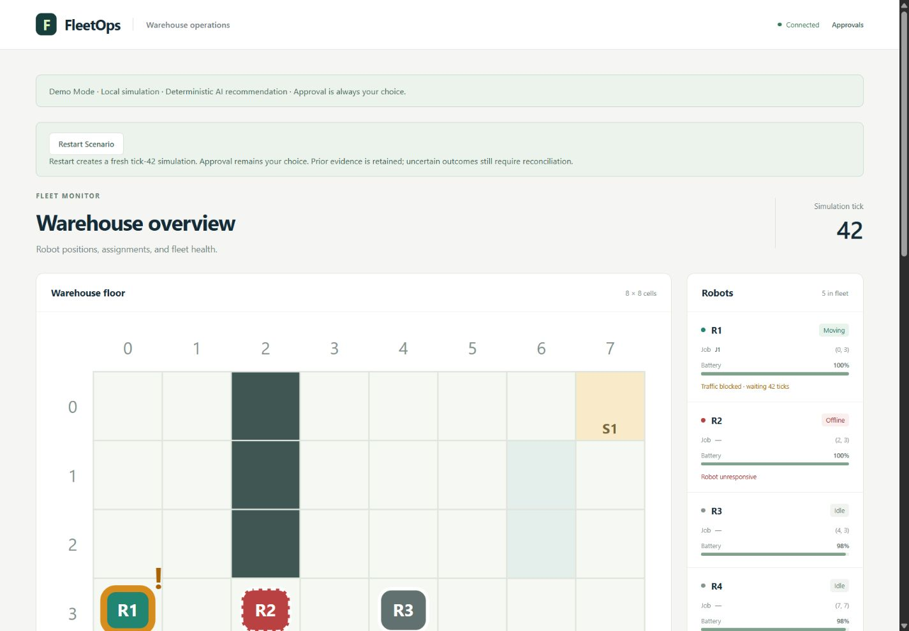
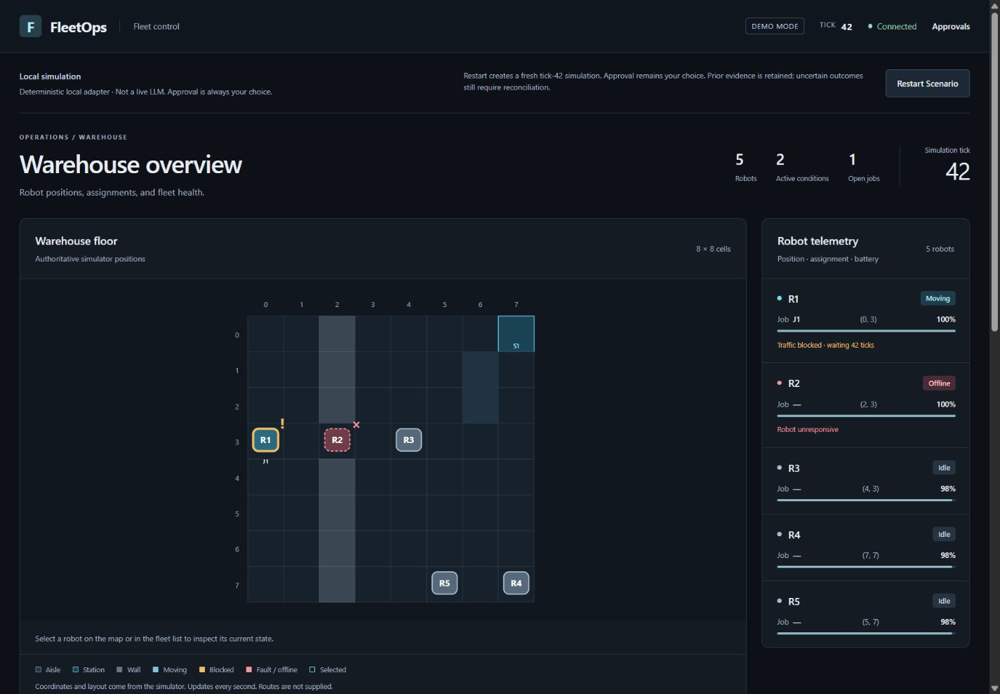

# FleetOps Phase 6 — DEMO-05 design review for Claude

Review date: 2026-10-17. Scope: the existing React dashboard, its visual system, presentation interactions, tests, and review evidence. This is an implemented application using real Go/PostgreSQL data, not a mockup. The reasoning source in these sessions is the deterministic local Mastra adapter, not a live LLM. No paid requests were made.

## A. Design goals

Make the operator's first task straightforward: understand the warehouse, identify an affected robot, inspect the recommendation, and make a deliberate decision. FleetOps should feel like precise engineering software with calm dark surfaces, restrained blue/cyan accents, clear typography, and meaningful whitespace. Tesla-inspired means restraint and hierarchy; no Tesla branding, copied screens, proprietary assets, decorative charts, invented routes, or neon/glow effects were used.

The safety model remains **LLM proposes. Go validates. Human approves. Go executes.** Presentation does not grant capabilities, bypass admission, or establish an execution outcome. An approval receipt confirms the returned transfer/charging result; subsequent job delivery comes from simulator telemetry. An offline obstruction can remain after a successful transfer.

## B. Before and after

Compare screenshots 01 and 03 at the same configured desktop viewport and initial tick-42 state; compare 02 and 06 for the pending decision experience.

| Original weakness | Implemented change | Evidence |
| --- | --- | --- |
| Two large notices consume the top of the page | Demo identity lives in the header; disclosure and restart share a compact toolbar | 01 vs 03 |
| Grid expansion pushes the lower warehouse out of the desktop viewport | SVG keeps its real coordinate system but gets a bounded display height and centered map surface | 01 vs 03 |
| Robot markers and cards provide no selection | Keyboard/click selection links the SVG, telemetry row, and related incident | 04, 05 |
| Repeated white panels give every section similar emphasis | Graphite surface hierarchy, restrained borders, stronger page/map headings and quieter metadata | 03, 05, 06 |
| Proposal fields read as a long metadata paragraph | Explicit job/source/recipient parameter group, provenance text, and differentiated Approve/Reject controls | 02 vs 06 |
| Outcomes need careful interpretation | Distinct observation, authorization, execution receipt, and simulator-outcome labels; retained uncertainty wording | 07, 08, 12 |





The numbered section labels identify conceptual stages rather than a linear wizard. Job progress stays near observations because it is continuously monitored even before a human decides. Review whether this numbering helps or creates friction given the visual reading order.

## C. Visual system

### Color

Tokens are in `web/src/styles.css`. Colors carry an additional text/status signal; color alone never identifies a state.

| Role | Value | Use |
| --- | --- | --- |
| Page | `#0d1117` | Near-black canvas |
| Surface | `#141b23` | Map/fleet/operations/approval regions |
| Raised | `#1a232e` | Secondary surface reference |
| Border | `#2a3644` | Thin structural separation |
| Primary text | `#e8edf3` | Headings and actual telemetry |
| Muted text | `#a4b1c1` | Supporting metadata, timestamps, coordinates |
| Accent | `#79d6ed` | Selection, focus and explicit approval action |
| Warning | `#efbd68` | Blockage, pending state, uncertainty |
| Critical/offline | `#f2979f` | Fault/offline markers and warnings |
| Healthy | `#9bd4b5` | Connected state and charging treatment |

Measured contrast against the actual token surfaces: primary text/surface **14.73:1**, muted/surface **7.96:1**, muted/raised **7.28:1**, accent/surface **10.45:1**, warning/surface **10.03:1**, critical/surface **8.01:1**. The automated tests enforce at least 4.5:1 for these text pairs and approval-button text. These checks are not a complete accessibility certification or exhaustive contrast audit of every SVG pixel.

### Typography, spacing and hierarchy

Use the existing system font stack (`Inter` when already available, then platform UI fonts), with no font download. Page title scales from 26–36px; section titles are 15–16px; primary robot IDs are 14px. Supporting text is 10–13px. Small metadata deserves independent readability critique, particularly at high zoom or on dense normal-server layouts.

Main spacing uses 14/16/20/22/24/28/32px, with 5–10px corner radii. There is no shadow/glow or gradient system. The map owns the largest region, telemetry is a narrow companion, observations and job progress follow, and the approval inbox spans the decision workspace. Four-color status badges distinguish moving, idle, charging, and offline/faulted, with words retained.

### Responsive behavior

- Above 1100px: map plus a 300px telemetry column; observations and outcomes share a row.
- At 1100px and below: telemetry narrows to 270px and operations stack.
- At 850px and below: map and telemetry stack; robot rows become a two-column grid; overview summary counts yield space to the map/tick.
- At 540px and below: header functions wrap, robot rows become one column, decision buttons share a row with 44px height, receipts use two columns, and supporting text wraps.
- The job table has local horizontal scrolling on a narrow screen; the page itself must not overflow horizontally.

## D. Dashboard walkthrough and data sources

1. **Header and demo toolbar:** FleetOps identity, Demo Mode, connection phase, current tick, approvals anchor, and normal-mode Disconnect. Local adapter disclosure is explicit. Restart remains the existing DEMO-04 operation with its loading and error messages.
2. **Overview instruments:** robot count, Go-provided active-condition count, and jobs whose status is not `done`. These are snapshot-derived counts, not invented historical KPIs or throughput claims.
3. **Warehouse:** `layout.cells`, dimensions, stations, robot positions/status/job IDs and current incidents from `FleetSnapshot`. Existing 40-unit grid coordinates and `viewBox` mapping remain authoritative. A station title uses actual occupied/reserved/available fields. A cyan outer selection ring is independent of amber blockage or dashed/red offline treatment. No route or intermediate motion is drawn.
4. **Robot telemetry:** actual identifier, status, job, position, battery meter, blockage/wait ticks and fault/offline text. Every row is a selection button with a full accessible telemetry label and pressed state.
5. **Observations:** only existing Go-classified incidents, severity and detached telemetry. Selection highlights a related condition while retaining other conditions. The Locate control selects that robot; it does not change simulator state or filter the list.
6. **Job progress:** current ownership, pickup/delivery coordinates and current job status. Reassignment and delivery remain separate facts. Screenshot 07 shows J1 delivered on R3 while R2 remains offline.
7. **Approval inbox:** existing canonical proposal fields, deterministic/local provenance in demo mode, parameter group, submitter/expiry, and existing decision gates. There is no new persisted reasoning field: normal mode still says “No rationale recorded.” The parameter group is not a claim that current telemetry has been revalidated in the browser.
8. **Decision receipt:** original execution/audit/attempt flags and stored-status refresh. Color differentiates recorded execution, rejection, decline/failure, and uncertain persistence. Missing audit acknowledgement still means “not confirmed”; it is never restyled into a success.

## E. Interaction behavior and accessibility

- Clicking a map marker, telemetry row, or incident selection control selects the same robot. Enter and Space work on SVG controls. The SVG uses a labeled group, so interactive descendants remain discoverable; a single `role=img` would hide them from accessibility APIs.
- Selection adds cyan emphasis and an explicit selected-robot status line. A clear-selection button is provided. The `Dashboard` is keyed by the existing demo generation, clearing presentation selection when the runtime changes. Selection does not alter a proposal or robot command.
- Approve and Reject retain their original pending/current-runtime/expiry/availability/busy guards. Only the existing explicit event handlers call the existing mutations. No automatic decision or mutation retry was added.
- Restart disables while preparing, clears the old decision receipt, and keeps the existing same-origin/generation handling. A successful replacement returns to tick 42 with a new pending proposal. Restart does not reconcile an old uncertain outcome.
- Loading, authentication failure, stale data, unavailable inbox and poison notices remain explicit. Stale telemetry is visibly dimmed and labeled; decisions are disabled. Normal bearer mode remains available without the demo marker.
- Focus rings, a skip link with a programmatically focusable main target, full robot button labels, pressed states, text severity/status, native battery meters and live feedback are retained/provided. Mobile Approve/Reject were measured at **151 × 44 CSS pixels** each in the tested viewport.
- Only color/background/border/stroke transitions are used. Robot transforms/positions do not interpolate, preventing invented movement through walls. The reduced-motion media rule disables transitions, animations and smooth scrolling. CSS tests verify that rule. The browser's OS preference was `reduce=false`; forced reduced-motion emulation was unavailable in this browser interface, so that runtime preference combination was not visually exercised.

## F. Technical implementation and exact changed frontend files

| File | Change |
| --- | --- |
| `web/src/App.tsx` | Composition, real snapshot summary, header/demo toolbar, linked selection and generation-keyed dashboard |
| `web/src/Warehouse.tsx` (new) | Extracted existing map/robot rendering, typed selection contract, accessible SVG controls and telemetry rows |
| `web/src/Operations.tsx` | Observation/outcome hierarchy and selected-robot incident emphasis |
| `web/src/ApprovalInbox.tsx` | Parameter presentation, provenance wording and receipt outcome styling; decision/authorization logic unchanged |
| `web/src/restart.tsx` | Visual wrapper class only; request, status polling and lifecycle behavior unchanged |
| `web/src/styles.css` | Dark token system, responsive layouts, states, focus and reduced-motion styles |
| `web/src/design.test.tsx` (new) | Eight focused rendering/accessibility/contrast/motion regressions |
| `web/vite.config.ts` | Process the actual stylesheet during tests so CSS assertions cannot pass against a mocked empty import |

Additional deliverables are this report, the 12 JPEGs below, and `captures.json` containing capture dimensions, sizes and SHA-256 checksums. Existing uncommitted DEMO-04/backend/documentation changes were preserved. No simulator, schema, safety rules, agent tools, dependencies, authorization policy or production API changed for DEMO-05.

The original `Warehouse` export from `App.tsx` is re-exported for existing callers. Selection is local React presentation state. Fleet/proposal request modules and GraphQL fields are unchanged. SVG station titles expose supplied occupancy information but the redesign does not infer aisle occupancy or provide robot paths, incident history, prediction, playback or control over time.

## G. Genuine screenshot gallery

All images are direct screenshots of the running local Go/PostgreSQL/React demo. No generated images, fake telemetry, DOM overrides, image edits, overlays or compositing were used. The browser returns JPEG bytes; extensions match that format. Captures contain proposal identifiers but no tokens, cookies, credentials or private connection configuration.

The in-app browser was configured to the CSS viewport sizes listed below. Its native capture returns the available raster area (which differs from the requested viewport); actual image dimensions are listed separately and verified from JPEG headers. These are scrolled viewport captures, not full-page composites. A full-page capture attempt was unsupported, so the gallery uses ordinary genuine viewport screenshots.

| Screenshot | CSS viewport | Actual raster | Reproduced state / description |
| --- | --- | --- | --- |
| [01 — Original desktop](evidence/phase6-ui/01-before-desktop.jpg) | 1440×1000 | 1425×990 | Original light UI, real tick 42, large notices and partially visible warehouse |
| [02 — Original approvals](evidence/phase6-ui/02-before-approval.jpg) | 1440×1000 | 1425×990 | Original observations, J1 on R1, and pending approval controls |
| [03 — Redesigned desktop](evidence/phase6-ui/03-after-desktop.jpg) | 1440×1000 | 1425×990 | Same deterministic tick-42 setup; complete warehouse and five telemetry rows |
| [04 — Robot selected](evidence/phase6-ui/04-after-robot-selected.jpg) | 1440×1000 | 1425×990 | Enter selected R1; cyan focus/selection independent of amber blockage |
| [05 — Active conditions](evidence/phase6-ui/05-after-incidents.jpg) | 1440×1000 | 1425×990 | Related R1 blockage highlighted, R2 offline still visible, job still awaiting pickup |
| [06 — Pending recommendation](evidence/phase6-ui/06-after-pending-approval.jpg) | 1440×1000 | 1425×990 | Local-adapter provenance, real proposal parameters, explicit human controls |
| [07 — Approved receipt and outcome](evidence/phase6-ui/07-after-approved-receipt.jpg) | 1440×1000 | 1425×990 | Automated test approval; committed transfer receipt; later real tick 242 shows delivered J1 and offline R2 |
| [08 — Rejected receipt](evidence/phase6-ui/08-after-rejected-receipt.jpg) | 1440×1000 | 1425×990 | Fresh run rejected through UI; committed audit, execution `none`, job remains on R1 |
| [09 — Fresh scenario](evidence/phase6-ui/09-after-restart-fresh.jpg) | 1440×1000 | 1425×990 | Restart after rejection; tick 42, cleared selection/receipt, new pending ID verified in DOM |
| [10 — Narrow tablet](evidence/phase6-ui/10-after-tablet.jpg) | 820×1180 | 805×1041 | Stacked layout, real full warehouse, compact header; telemetry follows below |
| [11 — Mobile decisions](evidence/phase6-ui/11-after-mobile.jpg) | 390×844 | 375×811 | Wrapped evidence, 44px decision controls, locally scrolling job table, no page overflow |
| [12 — Uncertain receipt](evidence/phase6-ui/12-after-uncertain-receipt.jpg) | 1440×1000 | 1425×990 | Actual isolated persistence failure; unknown execution, unconfirmed audit and disabled decisions. Poison warning was also verified above the screenshot viewport |

For 12, the audit table was temporarily unavailable only inside this disposable demo database. An explicit test approval failed persistence and Go poisoned that runtime. The table was restored; the controller captured the prior poison flag and historical records before creating a new service. This is failure injection for acceptance testing, not fabricated display data or a new product scenario. It does not establish manual reconciliation. All browser decisions in this review are automated acceptance activity, not evidence of human approval or live-model reasoning quality.

## H. Actual testing and verification

### Frontend

From `web/`:

```powershell
node node_modules/vitest/vitest.mjs run --pool=threads --no-file-parallelism --testTimeout=60000
npm run typecheck
npm run build
```

Final test output: **Test Files 8 passed (8); Tests 50 passed (50)**. Typecheck and production build exited 0. Eight new tests cover skip-link focus targeting, marker semantics/grounded coordinates, telemetry selection, linked incidents, real overview counts/stale/poison notices, canonical proposal parameters/provenance, WCAG token contrast, and reduced-motion/no-position-interpolation styles. Existing expiry, role, unknown receipt, authentication, transport and restart tests remain passing.

Initial verification issues are retained here: the first new test imported `node:fs`, which lacked Node type definitions in this frontend. Tests passed at runtime but typecheck/build failed. It was replaced with Vite's existing typed raw-import mechanism, with no dependency addition. Two style tests then failed because Vitest's default CSS handling returned an empty string; enabling stylesheet processing fixed that and tests now inspect the real stylesheet. These were test setup failures, not waived tests.

### Real Go/PostgreSQL integration

```powershell
pwsh -NoProfile -File web/scripts/verify-integration.ps1
```

Ran with the existing cached Go 1.27.1 executable on PATH and offline module settings. Exit 0: `TestDashboardHTTPIntegration` PASS, charging **0.91s**, reassignment **0.89s**, total **1.80s**; fleet package `ok ... 7.382s`. This exercised authenticated reads, typed inbox, approval/rejection, pickup/delivery, stale/duplicate/expiry/permission boundaries against real PostgreSQL. The existing demo launcher also built the apps and passed its controller/gateway/baseline checks before presenting the running application. No full backend golden/soak rerun is claimed for this frontend-only ticket.

### Real browser

- Desktop 1440×1000, tablet 820×1180, mobile 390×844 inspected and captured. DOM measurements: `scrollWidth == clientWidth` at all three: **1425**, **805**, **375** respectively; no page-wide horizontal overflow.
- The skip link initially scrolled without moving focus. Adding `tabIndex=-1` to the main region fixed the keyboard focus target; the final browser confirmed `document.activeElement` was `MAIN#main-content` after Enter on the skip link, with no warning/error console entries. Most visual captures predate this nonvisual focus correction; screenshot 03 was refreshed from the final build at the same desktop viewport.
- Enter selected R1 on desktop. Space selected R2 on mobile. The map, telemetry and incident states agreed; clear selection is available. Restart returned pressed-selection count to zero.
- Explicit UI approval produced `audit committed: Yes`, execution `succeeded`, and later delivery at tick 242. R2 remained offline. Explicit rejection produced execution `none` and no reassignment.
- Repeated restart showed disabled progress, cleared receipts, displayed loading, and returned a new pending proposal at tick 42. No automatic approval was triggered.
- Actual persistence failure produced unknown receipt, poison warning and disabled approval/rejection. The prior poisoned run was captured before replacement.
- A real temporary database pause exercised stale-data behavior: the last tick-42 snapshot remained visible with the stale map class, explicit incident/job/inbox warnings, and disabled decisions. The database was resumed and a fresh scenario requested through the existing controller.
- Before deliberate fault injection, browser warning/error logs were empty. Any connection errors during the planned outage check are backend-test effects, not redesign runtime errors.
- Reduced-motion CSS and token contrast are automated checks; full screen-reader testing, forced OS motion preference, 200% zoom, and browser-engine/device coverage remain manual follow-ups.

Static checks passed: `git diff --check` exited 0; all screenshot links resolved; 12 actual JPEG captures matched the capture manifest, dimensions and SHA-256 checksums. The image payload totals less than 1 MB. No dependency install, paid LLM request, commit, push, merge, branch switch, public deployment or DEMO-06 work was performed.

## I. Limitations and review boundaries

- This remains the bounded, loopback-only 20-minute local demo, not a public operations deployment. Restart does not extend session expiry. The DEMO-04 harness owns simulator lifecycle, persistence capture and cleanup.
- Screenshot and browser coverage concentrates on the existing 8×8/five-robot fixture. Large normal-server grids, very large fleets, long proposal queues and unusual identifiers deserve separate scale checks.
- Mobile requires scrolling between map, telemetry, incidents and decisions. The table intentionally scrolls inside its panel. Small SVG targets have an equivalent large telemetry-row control.
- Supporting text is compact; test contrast passes do not eliminate readability risk. There is no full screen-reader/zoom/device audit or forced reduced-motion browser run.
- No routes, robot interpolation, performance charts, incident history, model-written rationale persistence or explanation-to-proposal linkage were invented. There is no pause/resume, speed, playback, scenario menu, new tool, or new API.
- Runtime poisoning and audit uncertainty remain operational facts. A fresh scenario is not proof the previous uncertain outcome was reconciled. Local exports are not a production backup or full simulator checkpoint.

## J. Questions for Claude

Review the implementation and actual images together. Please critique:

1. Does the visual hierarchy make the warehouse the clear center of the experience?
2. Does the restraint read as premium engineering software and Tesla-inspired minimalism without imitating Tesla branding?
3. Are robot identity, blockage, offline state, selection and Go-classified severity readable without relying only on color?
4. Are the observation, local recommendation, evidence, human decision, execution receipt and later simulator outcome clearly distinguished?
5. Are Approve/Reject, unknown outcomes, reconciliation warnings and Restart Scenario sufficiently clear and appropriately weighted?
6. Do desktop, narrow tablet and mobile layouts preserve the right information and controls? Is the mobile scroll distance acceptable?
7. What concrete focus, text-size, contrast, motion, semantics or touch-target issues remain?
8. Are spacing, typography, color roles, component hierarchy and status treatments consistent? Does the whole application feel production-quality despite the explicitly local demo boundary?

Identify the **five highest-value UI/UX improvements**, in priority order. Ground each in a specific screenshot/component, explain its operator impact, and suggest a realistic frontend change. Favor clearer hierarchy, wording, layout and interaction over extra technology, new backend contracts or expansion into DEMO-06. Separate observed evidence from assumptions and call out any untested state you need before drawing a conclusion.

### Launch for independent review

From the repository root, with the existing dependencies, Docker, Node 24.21.0 and Go 1.27.1 available:

```powershell
pwsh -NoProfile -File evals/phase4/start-demo.ps1 -LocalDemo -Submit
```

Use the READY URL. For shutdown, use the existing `evals/dist/p405/stop` file workflow described in `docs/phase4-demo.md`. Do not label scripted/browser test approval as human approval acceptance.

## DEMO-05b addendum — 2026-10-17

The map and the existing approval inbox now share the first desktop workspace. This is a presentation refinement of DEMO-05. The branch remained `phase6-dashboard`; existing uncommitted work was preserved, with no commit, push, merge or branch switch.

### Layout decisions

- Desktop navigation is 60px high. The local-demo disclosure and existing restart control share a compact supporting row; the warehouse title and snapshot counts share one row. Only one prominent simulation-tick readout remains.
- The responsive SVG retains the simulator's coordinates, square cells, keyboard markers and linked robot selection. Its height scales from 340px to 700px on desktop; tablet/mobile use available width. At 1920×1080, actual cells measured approximately 78.43px square. At 1280×720, they measured 38.10px square: the shorter viewport trades map scale for complete first-screen visibility.
- A 400px desktop decision column contains the **single existing `ApprovalInbox`**, including pending, loading, forbidden, unavailable, empty and receipt states. Its handlers, validation, authorization, expiry/runtime gates, in-flight guard and receipt reconciliation behavior are unchanged. The decision region remains mounted when fleet telemetry is loading. No second approval workflow was created.
- Telemetry follows the map/decision workspace in five columns, then two on tablet and one on mobile. Below 850px, decisions stack directly after the map, before telemetry and observations. Long queues and receipts can extend the page; controls are not clipped into a fixed-height container.
- Panels use tonal separation and 16px corners with fewer structural borders. Supporting text formerly at 10–11px is now 12px. Floor, aisle, wall, station and robot legend swatches use the actual fill/outline styles, including amber blockage and dashed offline outlines.
- Coordinate axes remain persistent. Keyboard selection exposes the robot's precise position and state; the fleet list offers equivalent native buttons. Restart guidance is shorter, with uncertainty/reconciliation text retained. The recommendation identifies its deterministic local adapter and scripted demo facts, and explicitly says it is **not a live LLM**. No new reasoning evidence or persisted rationale is claimed.

### Genuine screenshots and measurements

All captures below come from the real loopback Go/PostgreSQL demo and production React bundle. There are no fabricated states, image edits or DOM overrides. The browser's JPEG raster differs slightly from its configured CSS viewport. The before comparison is at 1280×720; final responsive captures cover all four required sizes.

| Capture | CSS viewport | JPEG raster |
| --- | --- | --- |
| [Before](evidence/phase6-ui/demo-05b/before-1280.jpg) / [after](evidence/phase6-ui/demo-05b/after-1280.jpg) | 1280×720 | 1265×712 |
| [Large desktop](evidence/phase6-ui/demo-05b/after-1920.jpg) | 1920×1080 | 1905×1072 |
| [Tablet](evidence/phase6-ui/demo-05b/after-tablet.jpg) | 820×1180 | 805×1158 |
| [Mobile](evidence/phase6-ui/demo-05b/after-mobile.jpg) | 390×844 | 375×811 |
| [Approved receipt](evidence/phase6-ui/demo-05b/after-approved.jpg) | 1280×720 | 1265×712 |
| [Rejected receipt and empty inbox](evidence/phase6-ui/demo-05b/after-rejected.jpg) | 1280×720 | 1265×712 |
| [Fresh restart](evidence/phase6-ui/demo-05b/after-restart.jpg) | 1280×720 | 1265×712 |
| [Actual unavailable/stale state](evidence/phase6-ui/demo-05b/after-stale.jpg) | 1280×720 | 1265×712 |

[DOM measurements](evidence/phase6-ui/demo-05b/measurements.json) record square-cell dimensions, panel bounds and overflow checks. Both desktop panels fit the CSS viewport: warehouse bottom 714.40/1074.40px and decision bottom 684.80px at 720/1080px height respectively. Client width equalled scroll width at all four sizes (1265, 1905, 805, 375px). Mobile decisions measured 151.60×44px per button. [Capture manifest](evidence/phase6-ui/demo-05b/captures.json) records JPEG dimensions, byte sizes and SHA-256 hashes.

### Verification and limits

- `node web/node_modules/vitest/vitest.mjs run --root web --pool=threads --no-file-parallelism --testTimeout=60000`: **Test Files 8 passed (8); Tests 54 passed (54)**. New coverage checks single-inbox composition, empty/loading presentation, both action gates for expired/prior-runtime/decided proposals, and legend consistency. Existing stale, unknown-receipt, permissions, transport and restart tests pass.
- `npm --prefix web run typecheck` and `npm --prefix web run build`: exit 0. An intermediate build failed with `stream did not contain valid UTF-8`; the edit encoding and line endings were corrected before final verification. `git diff --check`: exit 0 (Git emits existing Windows line-ending notices).
- WCAG AA text checks enforce at least 4.5:1 for primary/secondary text, action text, status accents, coordinates, recommendation text, navigation metadata and uncertainty copy against their actual surfaces. Muted/surface remains 7.96:1 and muted/raised 7.28:1. Reduced-motion/no-position-interpolation assertions pass.
- Real browser: Enter selected R1 and exposed `(0, 3)`; the skip link moved focus to `MAIN#main-content`. Approval returned `approved`, execution `succeeded`, audit committed `Yes`; the empty inbox and original receipt remained visible. Restart showed disabled progress, cleared selection/receipt, and returned tick 42 with a new pending ID. Rejection returned execution `none`, audit committed `Yes`, and an empty inbox. These are automated demo checks, not human approval acceptance.
- The initial sandbox launch failed to access Docker. The permitted elevated launcher succeeded. Its final real demo/controller/gateway/baseline run ended `PASS`, `ok .../backend/fleet 101.821s`. Shutdown used the existing stop-file workflow. The resulting real outage retained the snapshot and pending proposal, showed explicit stale/unavailable warnings and disabled Approve. Browser warning/error logs were empty before shutdown; connection failures after shutdown are expected.
- Remaining limits: mobile/tablet require scrolling; large queues and long receipts may require desktop scrolling. Baseline screenshot coverage is limited to 1280×720. No full screen-reader, 200% zoom, forced reduced-motion, cross-engine/device audit, or new poisoned-runtime fault injection was performed; poison and unknown-outcome rendering retain automated coverage. No backend, simulator, API, dependency or DEMO-06 changes were made.

## DEMO-05c addendum — 2026-10-17

### Structural refinement

DEMO-05c replaces the overview/card composition with one continuous simulation workspace: a viewport-height warehouse canvas and a contextual operator rail in a **66.7% / 33.3%** desktop split. The 64px header now contains demo identity, connection state, decision navigation and the existing restart control. The separate demo toolbar, overview instruments and telemetry-card row have been removed. The warehouse retains one tick readout, coordinate axes and a compact bottom strip for selection and the expandable map key.

The actual grid is substantially larger without changing its SVG coordinates or simulator positions. At 1280×720, cells increased from approximately **38.10px to 60.46px** per side (59%). At 1920×1080, they increased from **78.43px to 100.80px** (29%). The canvas follows viewport height rather than an arbitrary 700px SVG cap. Square cells and the original robot/station geometry are preserved. No routes, intermediate positions or movement were invented.

The rail presents Go-reported incidents first, including affected robot, severity and job/wait context. The human action follows with a short action label, large job/source/recipient text, provenance and 48px Approve/Reject controls. There remains exactly **one `ApprovalInbox`**, using the original polling, authorization, validation, mutation handlers and receipt behavior. No incident-to-proposal relationship is inferred by the UI.

Native `<details>/<summary>` disclosures retain incident telemetry, proposal evidence/expiry/IDs/validation information, robot telemetry, job progress, restart explanation and the map key. Expiration and prior-runtime warnings, unavailable/poison notices, decision errors, execution/audit uncertainty, reconciliation guidance and stored-status refresh remain outside optional proposal evidence. The visible recommendation states **“Deterministic local adapter · not a live LLM.”** Normal mode retains “No rationale recorded.” Selection exposes position, battery, job and status on the canvas and highlights the related supplied incident.

Graphite surfaces now form two continuous regions rather than separate rounded dashboard cards. Tonal separation, larger primary text, restrained cyan selection/action treatment, and meaningful amber/red incident treatments establish hierarchy. Secondary copy remains 12–14px. Mobile stacks the canvas and contextual rail; the decision anchor provides direct navigation. Long queues, disclosures and receipts retain natural document scrolling while the desktop map stays visible.

### Actual before/after evidence

These are genuine browser captures of the existing loopback Go/PostgreSQL demo with production React assets. The before images show DEMO-05b; the after images show DEMO-05c at the same tick-42 fixture. No generated images, DOM overrides, compositing or screenshot edits were used. CSS viewport overrides and returned JPEG raster sizes differ slightly.

| State | CSS viewport | JPEG raster | Evidence |
| --- | --- | --- | --- |
| Compact desktop | 1280×720 | 1265×712 | [Before](evidence/phase6-ui/demo-05c/before-1280.jpg) · [After](evidence/phase6-ui/demo-05c/after-1280.jpg) |
| Large desktop | 1920×1080 | 1905×1053 | [Before](evidence/phase6-ui/demo-05c/before-1920.jpg) · [After](evidence/phase6-ui/demo-05c/after-1920.jpg) |
| Mobile | 390×844 | 375×811 | [Before](evidence/phase6-ui/demo-05c/before-mobile.jpg) · [After](evidence/phase6-ui/demo-05c/after-mobile.jpg) |
| Mobile human action | 390×844 | 375×811 | [Decision controls](evidence/phase6-ui/demo-05c/after-mobile-decision.jpg) · [Expanded evidence](evidence/phase6-ui/demo-05c/after-mobile-evidence.jpg) |
| Approved transfer / later simulator state | 1280×720 | 1265×712 | [Receipt](evidence/phase6-ui/demo-05c/after-approved.jpg) |
| Rejected / empty inbox | 1280×720 | 1265×712 | [Receipt](evidence/phase6-ui/demo-05c/after-rejected.jpg) |
| Fresh scenario at the main-content target | 1280×720 | 1265×712 | [Restart](evidence/phase6-ui/demo-05c/after-restart.jpg) |

The paired desktop captures were inspected together to check map scale, primary-action visibility and the removal of separate cards. [Measurements](evidence/phase6-ui/demo-05c/measurements.json) record actual bounds, square cells and the single inbox. At both desktop sizes, the active incidents and pending controls are visible on the first screen: button bottoms are **607.79px** and **646.80px** respectively. Client and scroll widths match at all three required sizes: **1265, 1905 and 375px**. Mobile buttons measure **162.60×48px**. [Capture manifest](evidence/phase6-ui/demo-05c/captures.json) records dimensions, bytes and SHA-256 hashes.

### Verification

- Final frontend command: `node web/node_modules/vitest/vitest.mjs run --root web --pool=threads --no-file-parallelism --testTimeout=60000`. Actual output: **Test Files 8 passed (8); Tests 57 passed (57)**. Added regressions cover incident/action composition and progressive disclosure without hiding essential warnings or uncertain receipts. Existing expiry, permissions, stale-runtime, unknown-outcome, transport and restart coverage passes.
- `npm --prefix web run typecheck`: exit 0. `npm --prefix web run build`: exit 0; Vite reports 23 modules transformed. Intermediate checks caught a newline-after-return TypeScript error, outdated presentation assertions, and a test that confused an HTML data attribute with visible identifier text. These were corrected; no failure was waived.
- Existing WCAG AA text contrast checks pass for primary/secondary text, coordinates, action text, recommendation text and status/uncertainty colors against their actual surfaces. Muted text remains 7.96:1 on the rail surface. Reduced-motion and no-position-interpolation tests pass; keyboard focus styling is retained.
- Real browser: Enter selects R1, exposes its precise position/battery/job, and highlights the R1 incident. Enter opens proposal evidence on mobile and exposes the real parameters, submitter, expiry and identifier. The skip link moves focus to `MAIN#main-content`.
- Real browser approval returns `approved`, execution `succeeded`, audit committed `Yes`, and execution attempted `Yes`. Stored-status refresh works. Subsequent Go telemetry shows J1 delivered by R3 at tick 242, while R2 remains offline. The original receipt distinguishes transfer from delivery.
- Real browser restart shows disabled progress, then a new pending ID at tick 42 with zero selected robots and zero old receipts. Rejection returns `rejected`, execution `none`, audit committed `Yes`, execution attempted `No`, and the empty inbox. A second restart restores a fresh pending proposal. These are automated acceptance actions, not human approval evidence. Browser warning/error logs were empty.
- The existing isolated launcher runs real PostgreSQL and reported controller/gateway security checks passing before READY. The preceding interactive run shut down with `PASS`, `ok .../backend/fleet 51.605s`; the final demo was then used for the workflow checks above. No full backend suite or new fault-injection run is claimed.

Files changed for DEMO-05c: `web/src/App.tsx`, `ApprovalInbox.tsx`, `Operations.tsx`, `restart.tsx`, `styles.css`, `ApprovalInbox.test.tsx`, `demo.test.tsx`, `design.test.tsx`, this document, and the `docs/evidence/phase6-ui/demo-05c/` captures/manifests. Existing working-tree changes were preserved on `phase6-dashboard`; no branch switch, commit, push or merge occurred. No backend, GraphQL, simulator, authentication, safety-rule, dependency or DEMO-06 changes were made.

Remaining limits: mobile requires scrolling; large incident/proposal lists or expanded evidence can move controls below the first viewport. Receipts remain fully readable rather than being forced into a fixed-height card. Full screen-reader, 200% zoom, forced reduced-motion, tablet and cross-engine/device audits were not performed for DEMO-05c. Poisoned-runtime and unknown-outcome behavior retain regression coverage but were not newly fault-injected in this browser run. The local demo has its existing bounded session lifetime.

## DEMO-05d — neutral palette refinement

Color declarations only were changed in `web/src/styles.css`; no component code, layout architecture or behavior changed. The application uses `#0B0C0E`, surfaces `#141518`, elevated surfaces `#202124`, primary text `#F5F5F5`, secondary text `#B9BBC1`, and an off-white `#E8E9EB` Approve action with `#17181B` text. Neutral gray replaces blue/teal in cells, robot bodies, station styling, selection, borders, telemetry, notices and receipts. Walls use `#66676C`; stations use a light neutral boundary and label. Reject remains transparent with a neutral outline. Amber blockage/warnings, red offline/critical states and green connection health remain meaningful exceptions.

Real browser captures compare the same pending tick-42 demo state:

| CSS viewport | Before DEMO-05c | After DEMO-05d | JPEG raster |
| --- | --- | --- | --- |
| 1280×720 | [Before](evidence/phase6-ui/demo-05d/before-1280.jpg) | [After](evidence/phase6-ui/demo-05d/after-1280.jpg) | 1265×712 |
| 1920×1080 | [Before](evidence/phase6-ui/demo-05d/before-1920.jpg) | [After](evidence/phase6-ui/demo-05d/after-1920.jpg) | 1905×1053 |

Visual comparison confirms no remaining broad navy-blue or cyan-heavy surfaces. [Computed colors and geometry](evidence/phase6-ui/demo-05d/measurements.json) confirm the intended theme and **0px geometry change** versus the DEMO-05c measurements for the map, rail, square cells and decision buttons at both sizes. There is no horizontal page overflow. Keyboard Enter still selects a robot; selection and focus outlines resolve to `rgb(232, 233, 235)`. Browser warning/error logs were empty. Images are genuine unedited local-demo captures; [the manifest](evidence/phase6-ui/demo-05d/captures.json) records dimensions and hashes.

Verification: `node web/node_modules/vitest/vitest.mjs run --root web --pool=threads --no-file-parallelism --testTimeout=60000` returned **Test Files 8 passed (8); Tests 59 passed (59)**. `npm --prefix web run typecheck`, `npm --prefix web run build`, and `git diff --check` exited 0. New palette and contrast regressions live in `web/src/design.test.tsx`; existing behavior and reduced-motion tests pass. Secondary text contrast is **9.51:1** on the main surface and **8.39:1** on elevated surfaces; primary-action text is **14.61:1**. Wall/floor separation and station boundaries meet the tested 3:1 graphical contrast target; robot labels exceed 4.5:1.

Scope complete. No new approval/rejection/restart exercise, fault injection, mobile or full accessibility audit was required/performed for this color-only pass. Existing changes and `phase6-dashboard` were preserved; no backend, GraphQL, simulator, dependency, paid-model or Git history changes were made.
